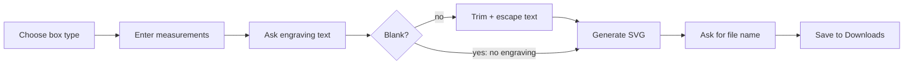

# Chapter 9 Analysis: Engraving Input Story

## Story one-pager

**Story:** Engrave my box · **Estimate:** 3 pts

**As a** maker, **I want** to type the text I want engraved when I generate a box, **so that** the SVG I send to the laser cutter already has my name or label on it.

**Description.** Every box type (simple, sticky note/notecard, sliding) can already draw engraving text into its SVG. But `MainApp` never reads what the user wants engraved: it prints "What would you like to engrave?" and moves on, so `engraving` is always empty. This story connects the prompt to the generators, and makes sure any text the user types produces a valid SVG.

**Tasks**

1. Read the engraving text after the "What would you like to engrave?" prompt and trim it.
2. Pass that text to `generateSimpleBoxSVG`, `generateSlidingBoxSVG` and `generateNoteHolderSVG`.
3. Move the repeated prompt code into one helper, so all box types ask the same way.
4. Escape `&`, `<`, `>` and quotes before engraving text goes into the SVG.
5. Add unit tests for the escaping and for the trimmed text reaching each generator.
6. Leave crate, hinge and flex boxes alone for now: they don't generate yet.

**Test criteria**

1. A user who asks for engraving and types `Blee` gets `BLEE` (or `Blee` for a simple box) in the saved SVG.
2. A user who skips engraving gets an SVG with no engraving text.
3. Leading and trailing spaces are trimmed.
4. The file-name prompt still appears after the engraving prompt and still works.

## Flowchart



Every box type follows the same path. Only non-blank text is trimmed and escaped before it reaches the SVG generator; the file-name prompt always comes last.

## Personas

Three kinds of user run the generator, and each needs something different from the engraving prompt.

| Persona                           | Who they are                                                                                           | What they need from engraving                                                                                              |
| --------------------------------- | ------------------------------------------------------------------------------------------------------ | -------------------------------------------------------------------------------------------------------------------------- |
| **"Maya" – the hobby maker**      | Makes gifts on a makerspace laser cutter. Comfortable typing commands, but not a programmer.           | A clear yes/no question, then one line to type the name. Wants to see the name on the box without editing the SVG by hand. |
| **"Dr. Reeves" – the instructor** | Teaches a fabrication lab and generates a batch of boxes for students, each labelled with a team name. | Fast, predictable prompts in the same order for every box type, so the steps can be written on a handout.                  |
| **"Jordan" – the lab technician** | Runs the laser cutter and loads the SVG files other people send.                                       | Files that always open. A stray `&` in someone's label must not break the file at the machine.                             |

## Paper prototypes

We sketched three ways to ask for engraving text in the console. Option 2 is the proposed design: it asks the same way for every box type and needs no special keyword.

**Option 1 – keyword on the measurement line (today's prompt)**

```
Enter all necessary measurements:
Format: "length width height toothWidth (optional) engraving"
> 100 80 60 5 engraving
What would you like to engrave?
> Blee
```

Short for experienced users, but the keyword is easy to miss, and the sticky-note box uses a different yes/no question.

**Option 2 – a separate question for every box (proposed)**

```
Enter length width height toothWidth:
> 100 80 60 5
Engrave text on the box? (leave blank for none)
> Blee
Enter a file name, or press Enter to generate one:
>
```

One prompt, the same for every box type. A blank answer means no engraving, so no yes/no step is needed.

**Option 3 – command-line flag**

```
java -jar box.jar --style sliding --size 100x80x60 --teeth 5 --engrave "Blee"
```

Best for Dr. Reeves's batches, but it's a bigger change to `MainApp`. On hold for a later story.

## Acceptance tests

The story is done when every row below passes in a demo, with the customer driving. Rows marked JUnit are also automated.

| #   | Given                        | When                                           | Then                                                              | Automated      |
| --- | ---------------------------- | ---------------------------------------------- | ----------------------------------------------------------------- | -------------- |
| 1   | Sliding box, 100 80 60 5     | User types `Blee` at the engraving prompt      | SVG has `BLEE` on the outer top (red) and the inner bottom (blue) | JUnit          |
| 2   | Sticky note holder           | User types `Blee`                              | SVG has `BLEE` centred on the bottom panel                        | JUnit          |
| 3   | Simple box, 100 60 80 5      | User types `  JDE  `                           | SVG has `JDE` on the top panel and a faded copy on the back       | JUnit          |
| 4   | Any box                      | User leaves the engraving prompt blank         | SVG has no engraving `<text>` element                             | JUnit          |
| 5   | Any box                      | User types `A&B <3`                            | SVG contains `A&amp;B &lt;3` and opens in a browser               | JUnit + manual |
| 6   | Any box                      | User finishes the engraving prompt             | File-name prompt appears and the file saves to Downloads          | Manual         |
| 7   | Generated SVG with engraving | Jordan loads it into the laser cutter software | Engraving shows as an engrave layer, separate from the cut lines  | Manual         |
