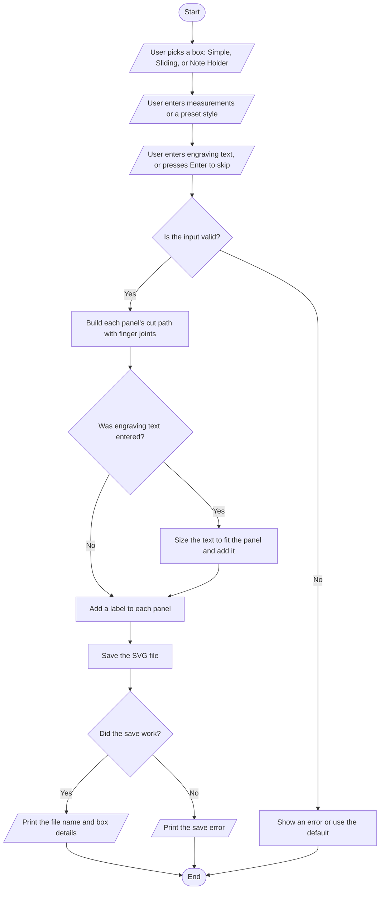
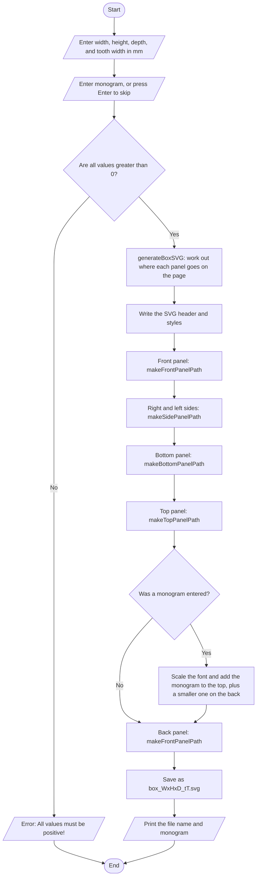
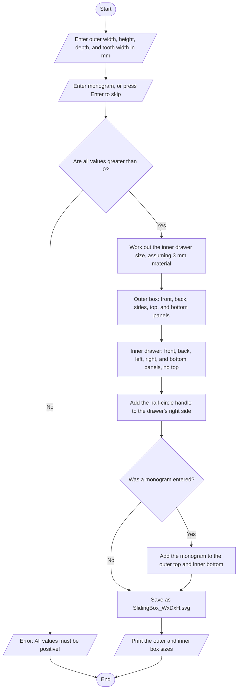
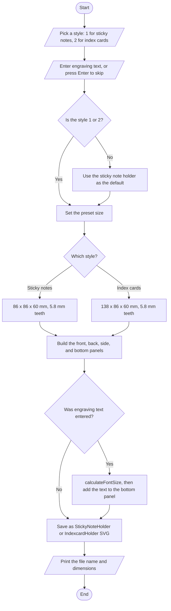

/*

FlowCharts.md
How each box goes from the user's input to an SVG file

Sarah Rawls - smr23a
Akram Idriss - ami22a
Isaac England - ile22a

*/

# Flow Charts

> **Note:** These charts show how the boxes run from the terminal (no UI). GitHub draws them automatically. In other editors, paste them into [mermaid.live](https://mermaid.live) to see them.

## 1. Overall Flow

Every box follows the same steps: get input, check it, build the panels, add the engraving, and save the SVG.

## 2. Simple Box (`SimpleBox.java`)

## 3. Sliding Box (`SlidingBox.java`)

## 4. Note Holder (`NoteHolderBox.java`)

