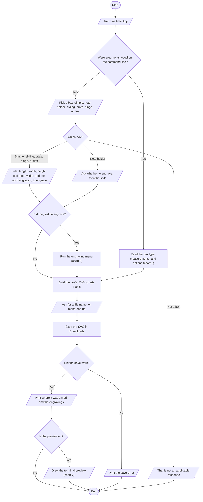
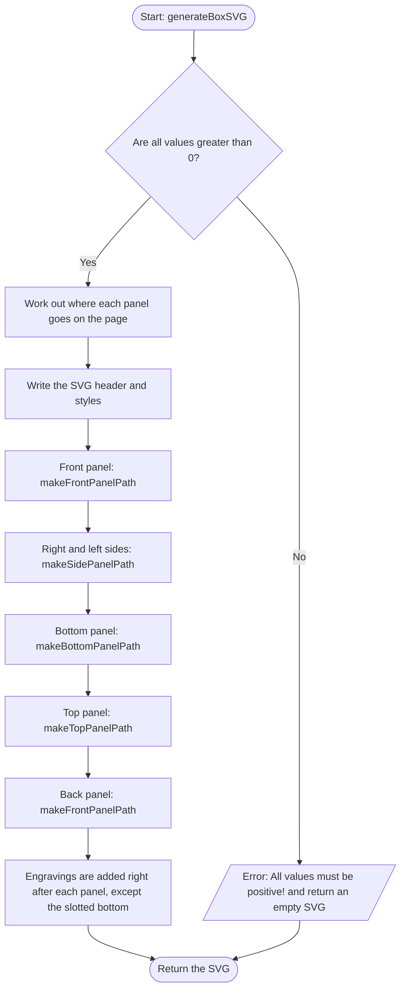
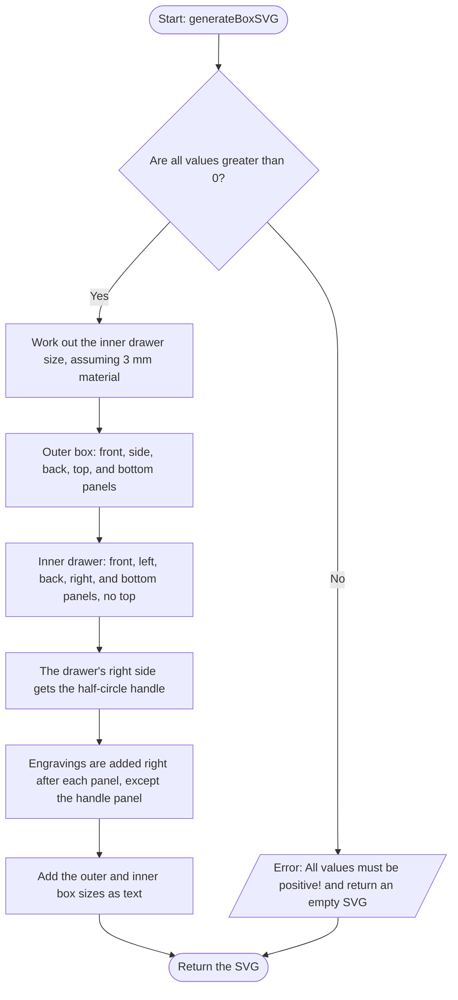
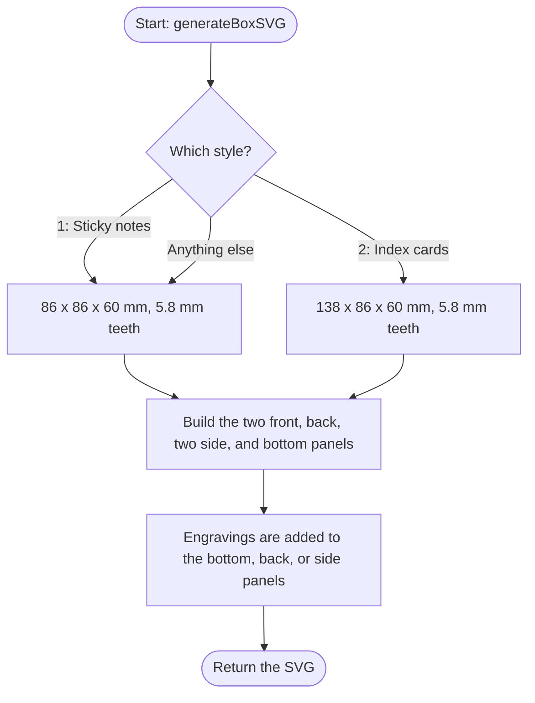

<!--

FlowCharts.md
How each box goes from the user's input to an SVG file

Sarah Rawls - smr23a
Akram Idriss - ami22a
Isaac England - ile22a

-->

# Flow Charts

> **Note:** GitHub draws these charts automatically. In other editors, paste them into [mermaid.live](https://mermaid.live) to see them.

## 1. Overall Flow (`MainApp.java`)

The app runs from the terminal in one of two ways: everything typed on one line, or answering questions when run with no arguments. Both end the same way. The files are saved in the user's Downloads folder.

Crate, hinge, and flex boxes aren't built yet, so for now they make a simple box. In one-line mode the file name is made up from the box and its size, so there is no file name question.

## 2. One-Line Options (`CommandLine.java`)

Example: `java -cp target/classes jimothypackage.MainApp simple 100 80 60 5 --text "Sarah's|Recipes" --font serif`

The first argument picks the box: `simple`, `sliding`, or `note`. The rest are read like this:

## 3. Engraving Menu (`EngravingMenu.java`)

Used in question mode when the user asks to engrave. Pressing Enter always takes the default.

## 4. Simple Box (`SimpleBox.java`)

## 5. Sliding Box (`SlidingBox.java`)

## 6. Note Holder (`NoteHolderBox.java`)

`MainApp` only accepts style 1 or 2 (or the words sticky, note, index, card); anything else prints an error.

## 7. Terminal Preview (`SvgAsciiPreview.java`)

The preview reads the finished SVG, so it shows what is really in the file and works for any box.

