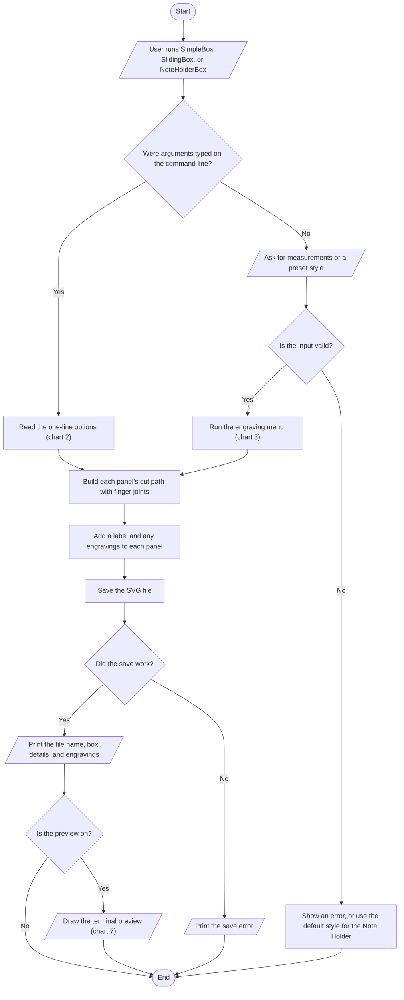
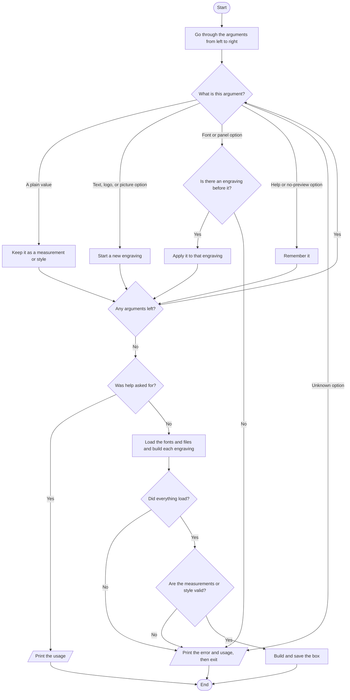
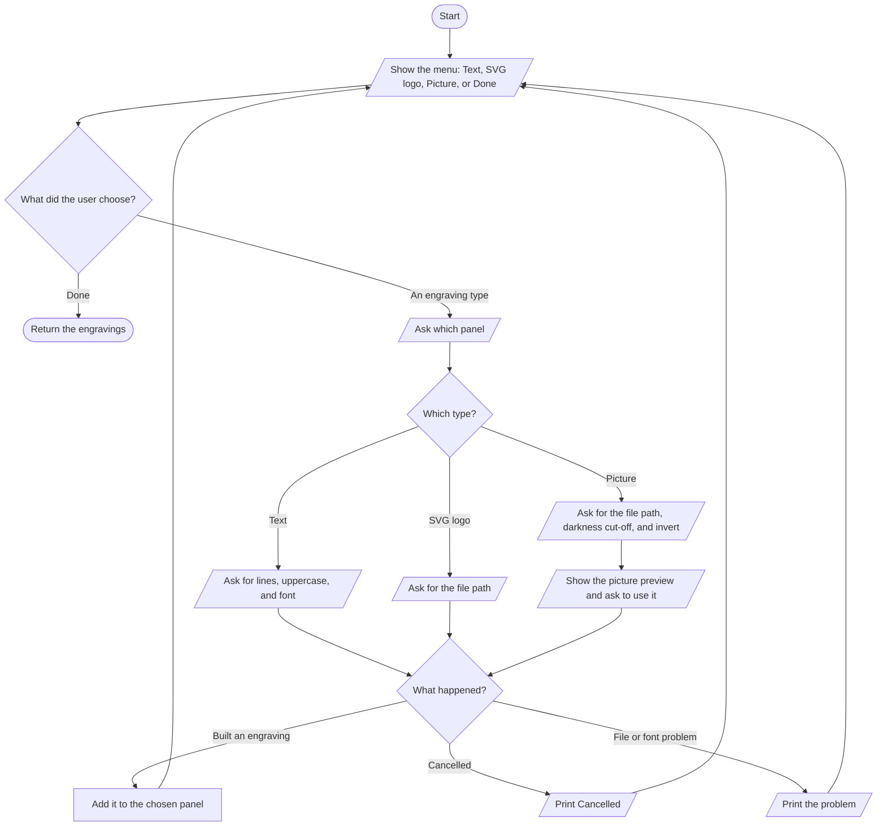
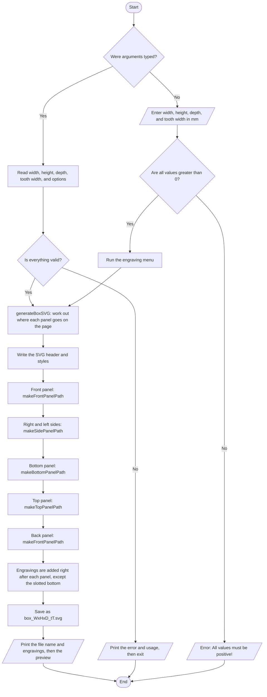
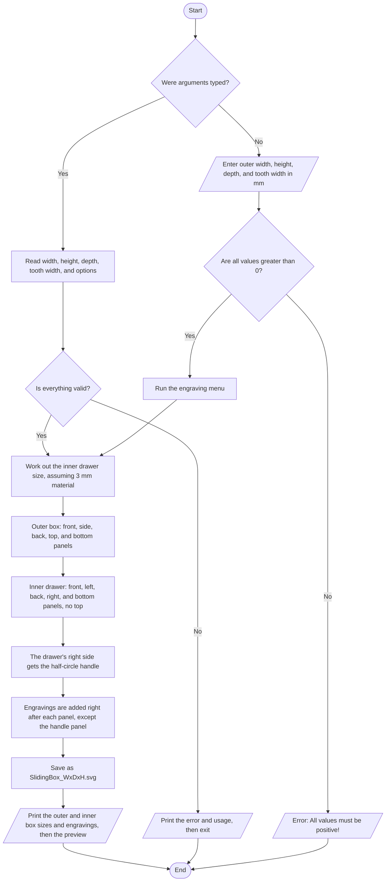
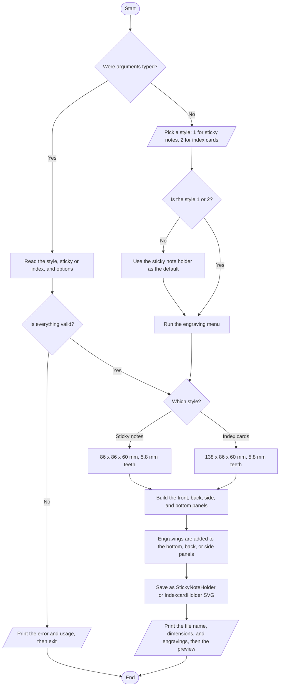
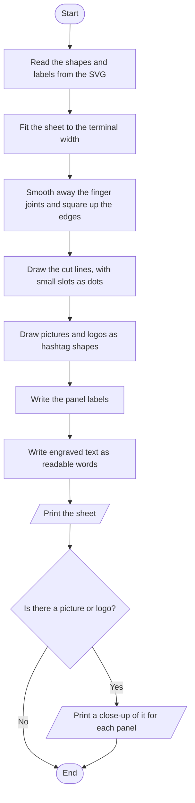

<!--

FlowCharts.md
How each box goes from the user's input to an SVG file

Sarah Rawls - smr23a
Akram Idriss - ami22a
Isaac England - ile22a

-->

# Flow Charts

> **Note:** GitHub draws these charts automatically. In other editors, paste them into [mermaid.live](https://mermaid.live) to see them.

## 1. Overall Flow

Every box runs from the terminal in one of two ways: everything typed on one line, or answering questions when run with no arguments. Both end the same way.

The Note Holder is the one exception to the error path: in question mode, an invalid style falls back to the sticky note holder and the program carries on.

## 2. One-Line Options (`CommandLine.java`)

Example: `java -cp target/classes SimpleBox 100 60 80 5 --text "Sarah's|Recipes" --font serif`

## 3. Engraving Menu (`EngravingMenu.java`)

Used when a box is run with no arguments. Pressing Enter always takes the default.

## 4. Simple Box (`SimpleBox.java`)

## 5. Sliding Box (`SlidingBox.java`)

## 6. Note Holder (`NoteHolderBox.java`)

## 7. Terminal Preview (`SvgAsciiPreview.java`)

The preview reads the finished SVG, so it shows what is really in the file and works for any box.

